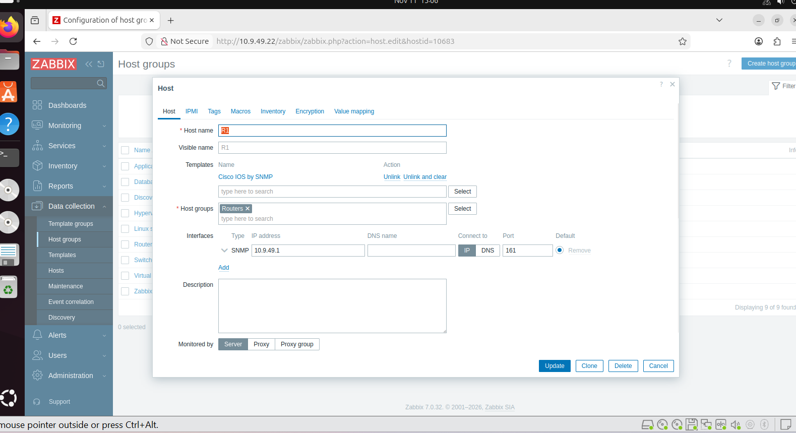
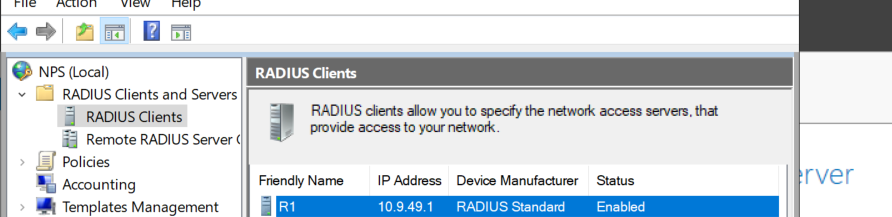
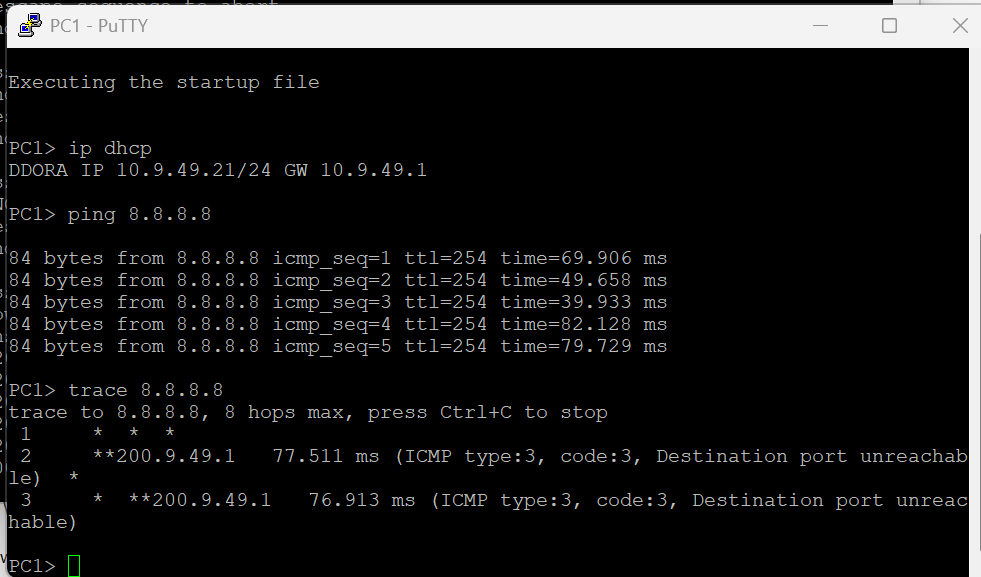
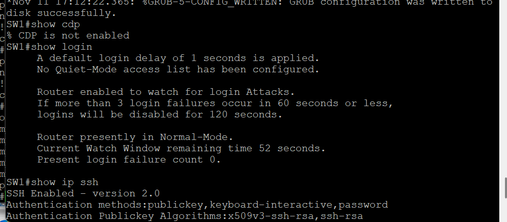
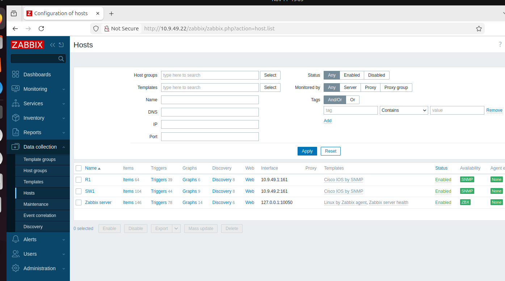
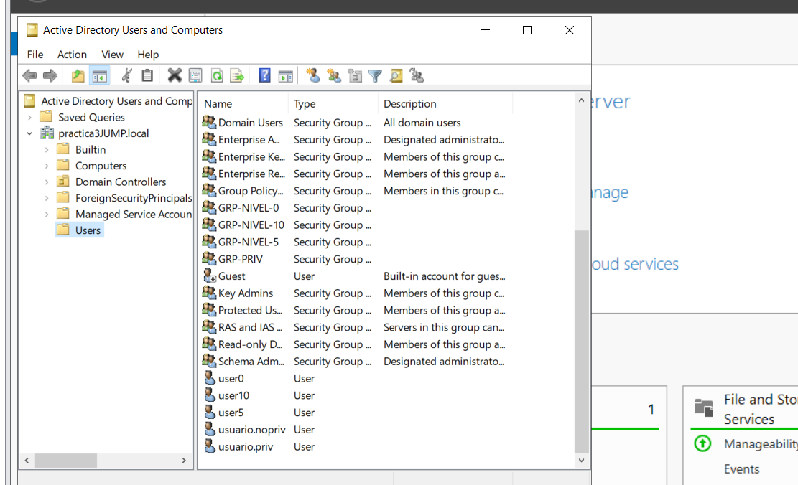

# Proyecto Final — Integración de Red Segura (Segundo Parcial)

**Estudiante:** Yuleidy Barrientos  
**Matrícula:** 2022-0949  
**Asignatura:** Seguridad en Redes — ITLA

## 🎥 Video de la práctica
▶️ **[Ver video en YouTube](https://youtu.be/f6YFFQQnmes)**

## 📌 Objetivo
Integrar en una sola topología los servicios y controles de seguridad del parcial: direccionamiento por matrícula, DHCP, NAT/PAT con salida al ISP, hardening CIS del switch, SSH sin Telnet con claves cifradas, router como cliente RADIUS con respaldo local, y monitoreo por SNMP (Zabbix).

## 🗺️ Topología

## 🔢 Direccionamiento (matrícula 2022-0949)
| Dispositivo | Interfaz | IP | Rol |
|---|---|---|---|
| ISP | Fa0/0 / Lo0 | 200.9.49.1 /30 · 8.8.8.8 /32 | WAN / Internet |
| R1 | Fa1/0 / Fa0/0 | 200.9.49.2 /30 · 10.9.49.1 /24 | NAT / Gateway |
| SW1 | VLAN 1 | 10.9.49.2 /24 | Gestión |
| PC1 | — | 10.9.49.21 (DHCP) | Cliente |
| SRV-WIN | — | 10.9.49.10 | RADIUS (NPS) |
| ZABBIX | — | 10.9.49.22 (DHCP) | Monitoreo SNMP |

## ✅ Requisitos y evidencias

### 1. Hardening del switch (CIS)
service password-encryption, enable secret, no ip http server, no cdp run, ip ssh version 2, login block-for, transport input ssh, exec-timeout, banner.

### 2. Servidor DHCP en el router
R1 entrega direcciones a la LAN; PC1 recibe 10.9.49.21.

### 3. Router como cliente RADIUS con respaldo local
R1 autentica usuarios de Active Directory contra el NPS (Access-Accept + shell:priv-lvl); si el RADIUS no responde, usa el respaldo local.

### 4. Monitoreo SNMP (Zabbix)
Zabbix (cliente DHCP) monitorea R1 y SW1 por SNMP v2c, comunidad RO_20220949.

### 5. Direccionamiento por matrícula + conectividad
Hostnames y direccionamiento según matrícula; conectividad verificada (ver Req 2 y 6).

### 6. NAT + ruta por defecto hacia el ISP
PAT en R1 y ruta por defecto; PC1 hace ping y traceroute a 8.8.8.8.

### 7. Repositorio en GitHub
Incluye README con evidencias, configuraciones por equipo y la carpeta de imágenes.

### 8. Acceso SSH (sin Telnet) con clave cifrada
transport input ssh (Telnet deshabilitado), SSH v2, service password-encryption.

## 🧩 Nota de resolución de problemas
Las VMs de VMware transmitían pero no recibían tráfico porque GNS3 no tenía interfaces VMnet libres. Se resolvió creando varias interfaces VMnet (host-only) en el Virtual Network Editor; tras ello RADIUS y SNMP funcionaron correctamente.
